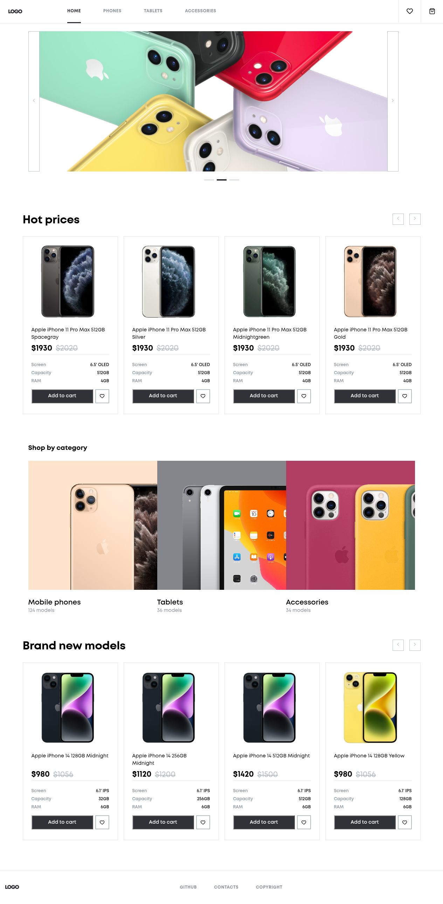

# Phone Catalog

A responsive storefront-style frontend for browsing phones, tablets and
accessories. The project demonstrates catalog filtering, URL-driven sorting and
pagination, product variants, favourites and a persistent shopping cart.

[Live demo](https://mykhailoloniak.github.io/react_phone-catalog/)



## Features

- Product catalog split into phones, tablets and accessories
- Search, sorting and pagination stored in URL parameters
- Detailed product pages with color and capacity variants
- Accessible product galleries, carousels and mobile navigation
- Favourites and cart persisted in local storage
- Loading, API error, retry and product-not-found states
- Responsive desktop, tablet and mobile layouts
- Reduced-motion support and route-specific page titles

## Technology

- React 18 and TypeScript
- React Router 7
- Vite 7
- Sass modules
- Vitest, ESLint, Stylelint and Prettier
- Cypress for end-to-end testing
- GitHub Actions and GitHub Pages

## Local development

Use Node.js 22. The expected version is recorded in `.nvmrc`.

```sh
nvm use
npm ci
npm run dev
```

The Vite development server prints the local URL after startup.

## Quality checks and production build

```sh
npm run format:check
npm run lint
npm test
npm run build
```

The production output is written to `dist/`. Preview it locally with:

```sh
npm run preview
```

## Deployment

Pushes to `master` run formatting, lint, tests and the production build in
GitHub Actions. GitHub Pages is deployed only after every quality check passes.

## Checkout status

This is a frontend portfolio demo backed by static product data. Checkout and
payment processing are intentionally unavailable, and the cart communicates
that limitation explicitly.

## License and credits

© Mykhailo Loniak. Distributed under the GPL-3.0 license. Product names,
trademarks and images belong to their respective owners and are used for
demonstration purposes.
